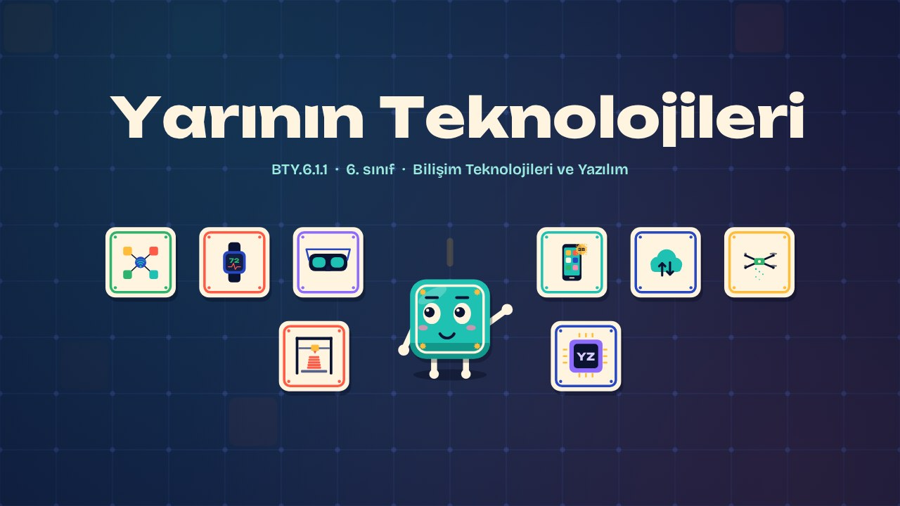
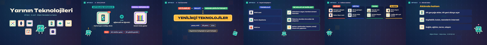

# Yarının Teknolojileri · Technologies of Tomorrow

**▶ Tarayıcıda izleyin / Watch in the browser:** https://hakanatas.github.io/yarinin-teknolojileri/ 
**⬇ MP4 + altyazılar / MP4 + subtitles:** [Releases](https://github.com/hakanatas/yarinin-teknolojileri/releases) 
**✎ Kullanılan istem / The prompt behind it:** [PROMPT.md](PROMPT.md) 
**🎞 Bütün filmler / All films:** [Bilişim Filmleri](https://hakanatas.github.io/bilisim-filmleri/?sinif=6)

> **TR —** 6. sınıf Bilişim Teknolojileri ve Yazılım dersinin "Bilişim Teknolojilerinin Hayatımızdaki Yeri" temasındaki BTY.6.1.1 öğrenme çıktısı için hazırlanmış, tamamen JavaScript ile çizilen 2,2 dakikalık animasyon; ses efektleri ve hafif fon müziği de kodla üretilir. Artırılmış gerçeklik ve sanal gerçeklik karşılaştırılarak yenilikçi bilişim teknolojilerine giriş yapılır. Giyilebilir teknolojiler, bulut depolama, nesnelerin interneti, yapay zekâ, 3B yazıcı ve dron gibi kavramlar tanıtılır. Bu teknolojilerin günlük hayatı nasıl kolaylaştırdığı örneklerle gösterilir. Son olarak yenilikçi teknolojiler sağlık, eğitim, tarım ve ulaşım gibi kullanım alanlarına göre gruplandırılır. Altyazılar Türkçe, İngilizce ya da ikisi birlikte seçilebilir.

A 2.2-minute animation, with code-generated sound, for **6th-grade IT and Software** (Türkiye Yüzyılı Maarif Modeli). AR and VR are compared; wearables, cloud storage, the Internet of Things, AI, 3D printers and drones are introduced; their role in making daily life easier is shown; and they are grouped by field: health, education, farming and transport. The guide is **Karo**, a living glazed tile who never speaks: he tells the story with his face, his arms and the blinking cursor above his head.

## Öğrenme çıktısı · Learning outcome

MEB, Türkiye Yüzyılı Maarif Modeli, Bilişim Teknolojileri ve Yazılım Dersi Öğretim Programı, 6. sınıf, 1. tema "Bilişim Teknolojilerinin Hayatımızdaki Yeri":

**BTY.6.1.1. Yenilikçi bilişim teknolojilerini sınıflandırabilme**
- a) Yenilikçi bilişim teknolojilerine ilişkin kavramları belirler.
- b) Yenilikçi teknolojileri, bilişim teknolojilerinin günlük hayatı kolaylaştırmadaki rolüyle ilişkilendirir.
- c) Yenilikçi bilişim teknolojilerini kullanım alanlarına göre gruplandırır.

## Sahneler · Scenes

| # | Zaman | Sahne | Ne oluyor | Çıktı |
|---|---|---|---|---|
| 1 | 0:00–0:16 | Giriş |  |  |
| 2 | 0:16–0:32 | AR mi, VR mi? | Artırılmış gerçeklik ile sanal gerçekliğin farkı. | a |
| 3 | 0:32–1:03 | Yeni kavramlar | Giyilebilir teknoloji, bulut, nesnelerin interneti; yapay zekâ, 3B yazıcı, dron. | a |
| 4 | 1:03–1:26 | Hayatı kolaylaştırır | Yenilikçi teknolojilerin günlük hayatı kolaylaştırmadaki rolü. | b |
| 5 | 1:26–1:56 | Kullanım alanları | Yenilikçi teknolojiler sağlık, eğitim, tarım ve ulaşım alanlarına göre gruplandırılır. | c |
| 6 | 1:56–2:13 | Aklında kalsın |  |  |

## Çalıştırma · Running it

- **Önizleme:** `index.html` dosyasına çift tıklayın (çevrim dışı da çalışır). Klavye: boşluk oynat/duraklat, ← → 3 sn, Home başa. Adrese `?altyazi=en`, `?bicim=vertical` ya da `?ses=0` eklenebilir.
- **MP4:** bir kez `npm install`, sonra `npm run export -- --format=both --captions=tr` (720p yatay ve dikey, sesli). Google Chrome yüklüyse Playwright onu kullanır (`channel: 'chrome'`); ffmpeg gerekir.
- **Altyazı ve seslendirme notları:** `npm run srt` → `out/yarinin-teknolojileri_tr.srt`, `_en.srt`, `_tr-en.srt`, `_seslendirme-notlari.txt`.
- **Sürüm dosyaları:** `npm run release` → `release/` klasöründe v1.0'ın 6 dosyası.
- **Yazı kontrolü:** `npm run check` yatay ve dikey düzende, üç altyazı seçeneğiyle üst üste binen, kenardan taşan ya da 720p'de 17 pikselden küçük kalan yazı arar.
- **Düzenleme:** senaryo (sahneler, altyazılar, seslendirme notları) `scenes/film.js` içindedir; değiştirince `npm run build` süreleri, `captions.js` ve `film.config.js` dosyalarını yeniden üretir. Sahne şablonları `src/kit/`, Karo `src/draw/karo.js`, ses `src/audio/synth.js`.

Her kare `renderFrame(t)` ile zamanın saf fonksiyonu olarak çizilir; rastgelelik tohumludur, MP4 ekran kaydı değil kare kare üretimdir. Ses de dosyadan çalınmaz: aynı olay listesinden hesaplanır. Yazı tipleri: Unbounded ve Bricolage Grotesque (SIL OFL 1.1), dosyaya gömülü.

## Lisans · License

**TR —** Bu film ve kodu [Creative Commons Atıf-GayriTicari 4.0 Uluslararası (CC BY-NC 4.0)](https://creativecommons.org/licenses/by-nc/4.0/deed.tr) lisansıyla paylaşılır. Ticari olmayan her amaçla (derste, okulda, eğitim materyalinde) kopyalayabilir, paylaşabilir ve değiştirebilirsiniz; ancak **kaynak göstermek zorunludur**: eser sahibinin adı ve bu deponun bağlantısı belirtilmeden kullanılamaz. Ticari kullanım (satış, ücretli ürün ya da yayın) için izin alınmalıdır.

**EN —** This film and its code are licensed under [Creative Commons Attribution-NonCommercial 4.0 International (CC BY-NC 4.0)](https://creativecommons.org/licenses/by-nc/4.0/). You may copy, share and adapt them for non-commercial purposes, but **attribution is required**: they may not be used without crediting the author and linking to this repository. Commercial use requires permission.

Atıf örneği / Required credit: *“Yarının Teknolojileri”, Hakan Ataş, Bilişim Filmleri — https://github.com/hakanatas/yarinin-teknolojileri — CC BY-NC 4.0*
